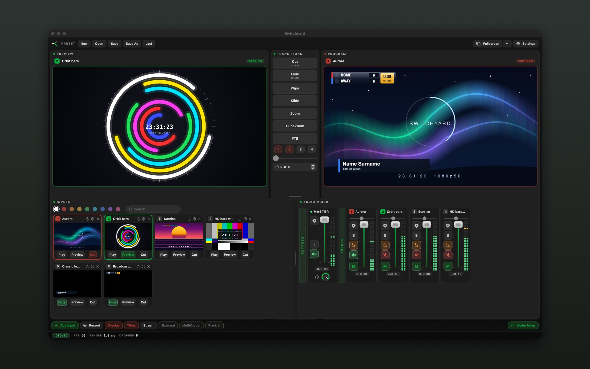
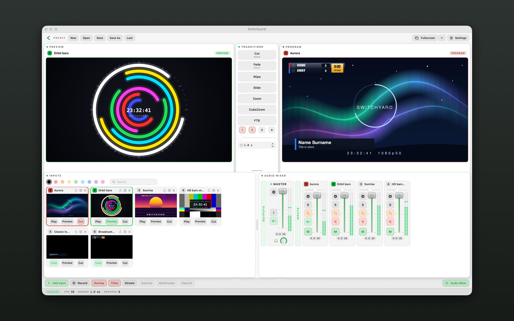
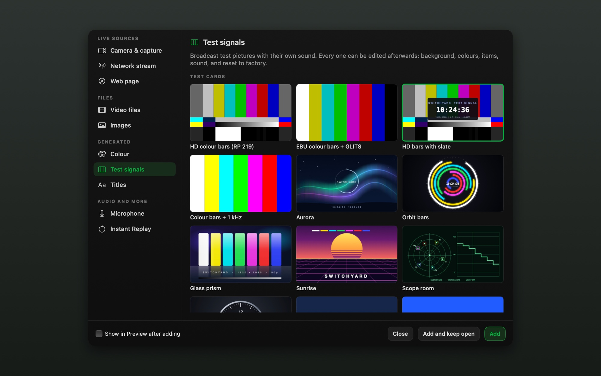
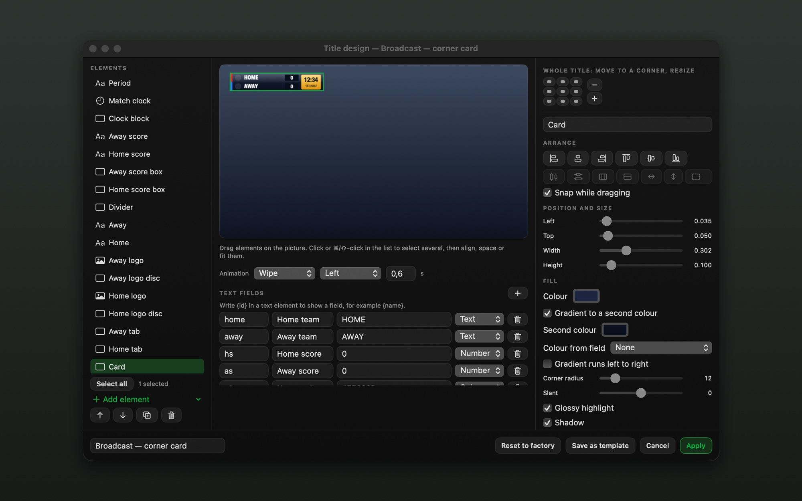

# Switchyard

**A live video switcher for the Mac.** Bring in cameras, capture cards, video files, web pages, streams and graphics, line the next shot up in Preview, send it to Program, and stream or record the result.

Free while in beta. Early testers will get a founder's discount when it goes paid.

## What it does
- **Sources:** cameras and capture cards (including Blackmagic DeckLink and UltraStudio), SRT and RTMP streams, HLS and MP4 links, video and image files, and web pages.
- **Switching:** Preview and Program, Cut, Fade, Wipe, Slide, Zoom, a T-bar, four overlay layers and fade to black.
- **Titles:** lower thirds, scoreboards, tickers, logos and clocks, with a built-in designer, four layers over Program and a rundown to step through.
- **Audio:** a mixer with faders, meters, mute, solo and auto audio that follows Program.
- **Output:** record to a file, stream over RTMP or SRT, and send Program or a MultiView to another display.

## Screenshots

**The main window**

**The same window in the light theme**

**Adding a source**

**The title designer**

## Download
Get the latest `Switchyard-<version>.dmg` from **[Releases](../../releases/latest)**. Open the image and drag Switchyard to Applications. It runs on Apple silicon and Intel Macs.

| | Minimum | Recommended |
|---|---|---|
| macOS | 14 Sonoma | 15 Sequoia or later |
| Mac | Intel Core i5 (2018 or later) or any Apple silicon | Apple silicon (M1 Pro or later) |
| Memory | 8 GB | 16 GB or more |
| Graphics | Any Metal-capable GPU | Apple silicon, or a discrete Radeon on an Intel Mac |
| Capture cards | Blackmagic Desktop Video 14.2 or later | the same, over Thunderbolt or USB 3 |

## Updates
Switchyard checks for new versions once a day and from **Switchyard → Check for Updates…**. It asks before installing, and never checks while you record or stream.

## Feedback and ideas
Switchyard is shaped by the people who use it. Write to **feedback@koridze.com**, and please do:

- **Suggest what you want to see.** A feature, a source or output you need, something that would make your show easier. Describe what you are trying to do, not only the feature; real examples help most.
- **Report bugs, with details.** Tell me what you did, what you expected and what happened instead, and whether it happens every time. Please include:
  - the Switchyard version (Settings → About), your Mac model and macOS version,
  - the capture card, camera or source involved,
  - a screenshot or a short screen recording, if you can.

## Third-party software
Switchyard includes Chromium Embedded Framework, libsrt, Sparkle and the Blackmagic Desktop Video SDK headers. See [THIRD_PARTY_NOTICES.md](THIRD_PARTY_NOTICES.md) for the licences. Blackmagic Design, DeckLink and UltraStudio are trademarks of Blackmagic Design Pty. Ltd.; Apple, Mac, macOS and Metal are trademarks of Apple Inc. Switchyard is not affiliated with either company.

## Licence
© 2026 Mirian Koridze. All rights reserved.
